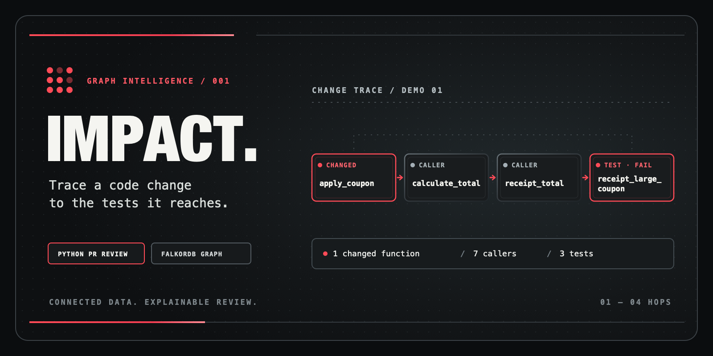

# IMPACT — PR impact agent

[](https://youtu.be/mbj6c4p4VNk)

IMPACT analyzes a Python pull request with a call graph in FalkorDB. It finds
functions that may be affected by a change, chooses relevant tests, and shows the
call paths that justify its suggestions. The graph is central: the review cannot
produce its impact paths or test selection without FalkorDB.

> **Larger real PR:** On [HTTPie #1327](https://github.com/httpie/cli/pull/1327),
> IMPACT indexed 956 functions from an application PR spanning 9 files. From a
> changed session constructor, FalkorDB found 21 possible callers, including 13
> tests, with paths up to 4 calls long. Across the PR, 18 selected test targets
> expanded to 43 cases:
> **34 passed, 9 remote-service cases skipped, 0 failed**.
> [Explore the graph, AI priority, and test results](https://omar8345.github.io/IMPACT/httpie-pr-1327/) ·
> [Read the report](docs/httpie-pr-1327/impact-report.md)

> **Inspect a complete GitHub PR review:** [Harbor Cart PR #1](https://github.com/Omar8345/impact-checkout-demo/pull/1)
> fixes an oversized-coupon bug in a separate, synthetic repository. IMPACT
> traced the changed function through its callers to three tests, ran them on
> both commits (**2 failed on the base; all 3 passed on the PR**), and linked
> the relevant owner, decision, and
> support ticket. [Explore the HTML review](https://omar8345.github.io/IMPACT/checkout-pr/) ·
> [Read the report](docs/checkout-pr/impact-report.md) ·
> [See the automated PR comment](https://github.com/Omar8345/impact-checkout-demo/pull/1#issuecomment-6247534059) ·
> [View the GitHub Actions run](https://github.com/Omar8345/impact-checkout-demo/actions/runs/39110757647)

## What the four runs showed

| Review | Selected tests | Observed result | Agent's next step |
| --- | ---: | --- | --- |
| [Coupon regression](https://omar8345.github.io/IMPACT/coupon-agent/) (synthetic) | 3 | 2 failed, 1 passed | Review the proposed discount cap, then rerun |
| [Harbor Cart fix PR #1](https://omar8345.github.io/IMPACT/checkout-pr/) (synthetic PR) | 3 on both commits | 2 base failures now pass; 0 new failures | Review the fix and remaining checks |
| [Requests PR #6644](https://omar8345.github.io/IMPACT/real-pr/) | 1 | 1 passed | Run the broader test suite |
| [HTTPie PR #1327](https://omar8345.github.io/IMPACT/httpie-pr-1327/) | 18 targets, 43 cases | 34 passed, 9 remote cases skipped | Run the skipped cases with the required service |

These are four case studies, not an accuracy benchmark. Test outcomes come
from actual runs; the AI's review priorities and next steps are shown alongside
them. The coupon fix is a proposal, not an applied or verified patch.

The project enters **Track 01: Agents That Act on Connected Data** and
**Track 03: Company Brain**. The graph analysis works without an LLM.
With `--llm`, an OpenRouter model queries graph tools and prioritizes a changed
function and a verified test. The application checks those choices and renders
the review from graph and test results. After an optional test run, the agent
chooses a next review action from the observed outcomes. If a test fails, it may
suggest a candidate fix; that suggestion is clearly marked unverified and is
never applied to the repository.

**What is the agent?** In `--llm` mode, a model calls FalkorDB-backed tools to
inspect changed functions, then chooses a review priority from graph-verified
options. With `--run-tests`, IMPACT executes the selected tests and records their
real outcomes. This is a bounded review agent, not an autonomous developer or a
chatbot. Without `--llm`, the same graph and test workflow runs deterministically.

## Graph data model

FalkorDB stores a `File` node for each Python file and a `Function` node for
each function or test. A `DEFINES` edge links a file to its functions. A `CALLS`
edge points from a caller to the function it calls. Function nodes store their
file, qualified name, line range, and whether they are tests. IMPACT follows
`CALLS` edges backward from a changed function to find possible impact and
relevant tests. The exact Cypher and PageRank/shortest-path queries are in
[graph_queries.md](docs/graph_queries.md).

For the optional company context, the same graph also stores `Person`, `Team`,
and `Knowledge` nodes. `OWNS` connects a person to a file, `MEMBER_OF` connects
them to a team, and `ABOUT` connects a decision, ticket, or chat source to a
function. A review can use these links to suggest the right reviewer and cite
the source behind a policy or incident.

## What you see in the demo

<a href="https://youtu.be/mbj6c4p4VNk"></a>

[▶ Watch the 2:09 demo on YouTube](https://youtu.be/mbj6c4p4VNk)

[Read the article about how IMPACT works](https://omarcodes.io/IMPACT).

`demo_checkout` is a synthetic shop with an intentional one-line coupon bug.
The agent traces `apply_coupon` through checkout and receipts to three tests.
When asked to run those tests, it confirms that the two large-coupon cases fail
and the normal-coupon case passes. A call path means _potential impact_;
only running a test establishes its actual result.

[Explore the coupon agent review](https://omar8345.github.io/IMPACT/coupon-agent/):
it shows the failing tests, their FalkorDB call path, and a candidate fix that
the agent proposes for human review.

## Requirements

- Python 3.11 or newer
- FalkorDB, either [Cloud](https://app.falkordb.cloud/) or local Docker
- An OpenRouter API key **only** if you use `--llm`

Install the Python dependencies from this directory:

```bash
python3 -m venv .venv
source .venv/bin/activate
python -m pip install -r requirements.txt
```

### FalkorDB Cloud

Copy your instance's host, port, and username from the Cloud dashboard. In zsh:

```bash
export FALKORDB_HOST='your-instance-host'
export FALKORDB_PORT='your-instance-port'
export FALKORDB_USERNAME='your-instance-username'
export FALKORDB_SSL=false
read -s 'FALKORDB_PASSWORD?FalkorDB password: '
export FALKORDB_PASSWORD
```

The Free tier does not offer TLS. Its connection is unencrypted, so use only
synthetic demo data and a unique database password. For an instance that offers
TLS, set `FALKORDB_SSL=true`. Never put credentials in the repository.

If you prefer a reusable file, copy [.env.example](.env.example), fill in your
own values, and load it in the terminal before running the commands:

```bash
cp .env.example .env
chmod 600 .env
nano .env
source .env
```

The app reads exported variables; it does not load `.env` automatically. The
real `.env` is ignored by Git. Leave `OPENROUTER_API_KEY` empty unless you use
`--llm`.

### Local FalkorDB

```bash
docker run --rm -p 6379:6379 falkordb/falkordb:latest-alpine
```

The default connection is `localhost:6379` without a password or TLS.

## Local evaluation for judges

IMPACT is a command-line tool that generates a standalone HTML report. A hosted
web service is not required to run it. A judge can clone the repository, follow
the virtual environment setup above, start local FalkorDB with the Docker
command above, then run the full demo commands below. The demo uses fictional
data and needs no API key unless `--llm` is requested. The hackathon submission
links to the working screen-recorded demo above; the video is not stored
in this source archive. To evaluate the model-guided agent path, use an
OpenRouter key and the `--llm` command under “Optional AI graph-tool use.”

## Run the full demo

From this directory, with FalkorDB running and the virtual environment active:

```bash
python main.py index ./demo_checkout
python main.py doctor
python main.py review ./demo_checkout --diff-file ./demo_checkout/coupon_bug.patch --run-tests \
  --html ./demo_checkout/impact.html --report ./demo_checkout/impact-report.md
open ./demo_checkout/impact.html
```

`index` parses the repository and replaces the selected FalkorDB graph.
`doctor` checks the graph traversal, PageRank, and shortest-path support on your
instance; it is read-only.
`review` reads the Git diff, follows callers up to four hops, runs graph-selected
tests, prints a Markdown review, and saves the HTML explorer and Markdown report.
It tracks edited lines rather than marking a whole diff hunk as changed. Tests
edited directly in the diff are included in the selected test run too.
The expected demo run reports two failed tests and one pass with pytest. If
pytest is unavailable, unittest reports one error, one failure, and one pass.
The review command still completes so the report can be inspected.

### Add the engineering company context

The checkout demo includes a **fictional** engineering team, decision record,
support ticket, and chat excerpt. Load them into the same graph as the code:

```bash
python main.py index ./demo_checkout --company-file ./demo_checkout/company.json
python main.py company shop/pricing.py::apply_coupon
python main.py review ./demo_checkout --diff-file ./demo_checkout/coupon_bug.patch \
  --run-tests --html ./demo_checkout/impact.html --report ./demo_checkout/impact-report.md
open ./demo_checkout/impact.html
```

The `company` command answers who owns the function and which source documents
explain it. The review adds a suggested reviewer and citations to both Markdown
and the HTML panel. The agent follows graph links for these answers; the names
and policies are never inferred from code alone. Edit `company.json` or its
source files and rerun `index --company-file` to refresh them. Indexing without
`--company-file` resets this extra context. This is a curated demo dataset,
not an automatic Slack or ticket connector.

The HTML template is [impact_template.html](impact_template.html). Generated
`impact.html` files are overwritten on the next review run. The page has light
and dark modes, selectable call paths, an agent priority panel when `--llm` is
used, and explicit test results when tests ran.

To analyze another **public or otherwise permitted** Python repository:

```bash
python main.py index /path/to/repo
python main.py review /path/to/repo --base main --run-tests \
  --html impact.html --report impact-report.md
```

Use a dedicated `FALKORDB_GRAPH` value or database instance when switching
repositories. Indexing replaces that graph. The installed `pytest` runner runs
exact selected test IDs for pytest functions and `unittest` methods. If pytest
is unavailable, IMPACT falls back to the Python standard library for `unittest`
class methods. Install the target repository's own dependencies before using
`--run-tests`; IMPACT does not install or infer them automatically. It places the
checkout's `src/` and root on the test process's Python path so tests import the
code being reviewed.

For another Python test runner, supply a command template. IMPACT runs one
selected test at a time without a shell. `{test}` is a pytest-style ID and
`{unittest}` is a dotted `unittest` class method; `{python}` is this virtual
environment's Python executable:

```bash
python main.py review /path/to/repo --base main --run-tests \
  --test-command '{python} -m unittest -v {unittest}'
```

## Review a GitHub PR by URL

For a public GitHub PR that changes Python functions, run this from the IMPACT
project directory after loading your FalkorDB settings:

```bash
python main.py pr https://github.com/OWNER/REPO/pull/123 \
  --html impact.html --report impact-report.md
open impact.html
```

`pr` fetches the PR, checks out its exact head commit in a temporary directory,
and compares it with the merge base of the PR's base commit. It then replaces the
selected FalkorDB graph with that checkout's call graph and saves the report and
HTML in your current directory. The temporary checkout is removed afterward.
Public PRs need no GitHub login for reading. This command does not run PR code.

If a PR repository contains a `company.json` manifest and its local sources,
pass `--company-file company.json` to include that context in the review.

To run its graph-selected tests, add `--run-tests`. Only use that for code you
trust; it executes code from the PR on your machine. Add `--llm` if you also
want the optional OpenRouter graph-tool step.

To check whether those selected tests changed outcome, add `--compare-base`
alongside `--run-tests`. IMPACT runs the same tests on the PR's exact base commit
when they exist there, then shows a base-versus-PR table in Markdown and HTML.
Tests added only in the PR are marked inconclusive for the base. This also runs
code from the base commit, so use it only with repositories you trust.

```bash
python main.py pr https://github.com/OWNER/REPO/pull/123 \
  --run-tests --compare-base --llm
```

To publish the generated report as a comment on the PR timeline, authenticate
GitHub CLI (`gh auth login`) and explicitly add `--post-comment`:

```bash
python main.py pr https://github.com/OWNER/REPO/pull/123 --post-comment
```

You need permission to comment on that PR. The comment contains the Markdown
report, including test output if you chose `--run-tests`; the local HTML file is
not uploaded. If the PR head changes while it is being fetched, rerun the command.
Current PR analysis covers functions present in the new checkout; fully deleted
or renamed functions need a future comparison of both code versions.

For CI, the [sample repository's manual GitHub Actions workflow](https://github.com/Omar8345/impact-checkout-demo/blob/main/.github/workflows/impact-review.yml)
starts FalkorDB in the runner, compares selected tests on both PR commits,
uploads the Markdown and HTML reports, and updates a PR comment. Its test job
has read-only access; a separate job posts the comment. It accepts PR branches
from that repository and needs no cloud database or AI key.

The Requests example requires the target project's runtime dependencies to run
its tests. The HTTPie example shows a larger change and an isolated test run;
remote-service cases were skipped because outside network access was disabled.
The synthetic checkout demo above shows a longer path and failing tests without
extra target dependencies.

## Optional AI graph-tool use with OpenRouter

OpenRouter's `openrouter/free` route is the code default. Availability and
output can vary because it routes among free models. The sample environment
file selects `openai/gpt-5.6-luna`, which is a paid model; change
`OPENROUTER_MODEL` to `openrouter/free` if you prefer the free route. Set your
key without putting it in shell history:

```bash
read -s 'OPENROUTER_API_KEY?OpenRouter API key: '
export OPENROUTER_API_KEY
python main.py review ./demo_checkout --diff-file ./demo_checkout/coupon_bug.patch --llm \
  --run-tests --html ./demo_checkout/impact.html --report ./demo_checkout/ai-review.md
```

`--llm` sends changed-function IDs and up to 12,000 characters of the diff to
OpenRouter. With `--run-tests`, it also sends selected-test statuses and a
truncated runner output for the post-test decision. Use it only with code and
test output you are allowed to send. The model receives
FalkorDB-backed tools and must support tool calling. The deterministic review
remains available without any API key. If the selected model or API fails, the
command falls back to that graph review and says why.
The model queries `impact_of_change` for each changed function, then chooses
which changed function and eligible test to inspect first. The application
validates both IDs against the diff and FalkorDB results. With `--run-tests`,
that test runs first, followed by every other selected test. The report and HTML
show the AI priority, observed test results, and next action. The application
derives the verdict from real test statuses; model prose cannot change test
counts or mark skipped cases as passed.

## Architecture and limitations

Read [architecture.md](docs/architecture.md) for an explanation of the parser,
graph, agent, and UI. [graph_queries.md](docs/graph_queries.md) lists the data
model and the Cypher queries used by the product. [learn_it.md](docs/learn_it.md)
is a plain English walkthrough and a set of judge questions to practice.

The parser resolves explicit Python imports, local functions, module aliases,
constructors, nested helpers, `self`/`cls` calls, and methods on objects clearly
constructed in a local variable. It does not infer general dynamic dispatch,
reflection, monkey-patching, or runtime imports. Results are potential impact,
not a claim that every reachable caller breaks.

## Development checks

```bash
python -m unittest discover -s tests -v
```

The synthetic checkout repo is deliberately broken; its two failing tests are
part of the demonstration, not a failure of this project's test suite.

## AI assistance

Codex assisted with code, including helper functions, the HTML report template,
and tests. It also helped create the sample `demo_checkout` repository and write
documentation, including this README.
